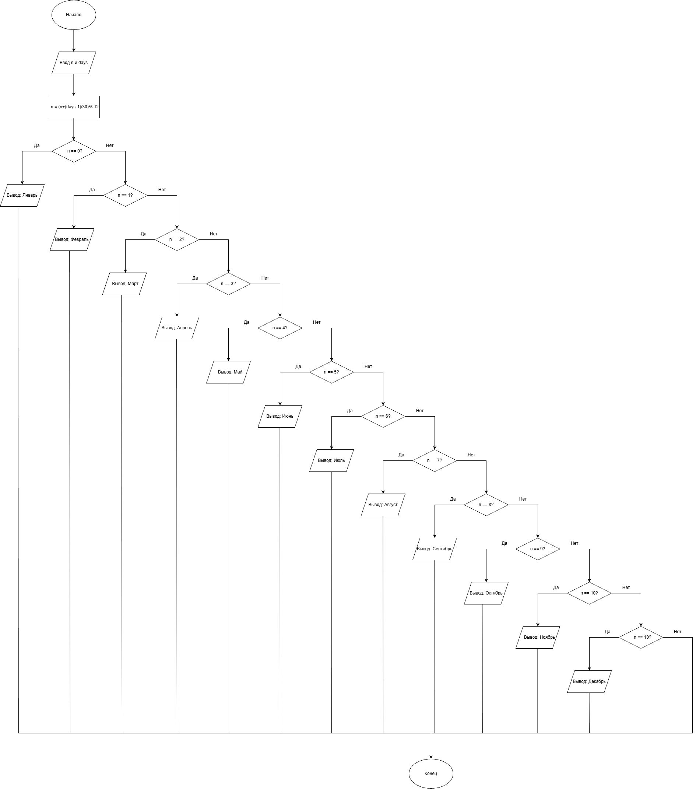

# Домашнее задание к работе 7

## Условие задачи

С января 2000 года по некоторый день прошло n месяцев и 3 дня. Определить название месяца этого дня. Предусмотреть возможность задания другого числа дней.

## 1. Алгоритм
### Алгоритм
```
1. Начало
2. Ввести n, days
3. month = (n + (days - 1) / 30) % 12 + 1
4. switch (n): 0-Январь, 1-Февраль, ..., 10-Ноябрь, 11-Декабрь
5. Конец
```
### Блок-схема


## 2. Реализация программы
```
#define _CRT_SECURE_NO_WARNINGS
#include <stdio.h>
#include <locale.h>

int main()
{
    setlocale(LC_ALL, "RUS");
    int n, days, month;
    printf("Введите количество месяцев: ");
    scanf("%d", &n);
    printf("Введите количество дней: ");
    scanf("%d", &days);
    month = (n + (days - 1) / 30) % 12 + 1;
    switch (month) {
    case 1: printf("Январь"); break;
    case 2: printf("Февраль"); break;
    case 3: printf("Март"); break;
    case 4: printf("Апрель"); break;
    case 5: printf("Май"); break;
    case 6: printf("Июнь"); break;
    case 7: printf("Июль"); break;
    case 8: printf("Август"); break;
    case 9: printf("Сентябрь"); break;
    case 10: printf("Октябрь"); break;
    case 11: printf("Ноябрь"); break;
    case 12: printf("Декабрь"); break;
    }
}

```
### 3. Результаты работы программы
```
Введите количество месяцев: 11
Введите количество дней: 40
Январь

Введите количество месяцев: 25
Введите количество дней: 3
Февраль
```
### 4. Информация о разработчике

Дегтярева Полина, бИЦТ-262
